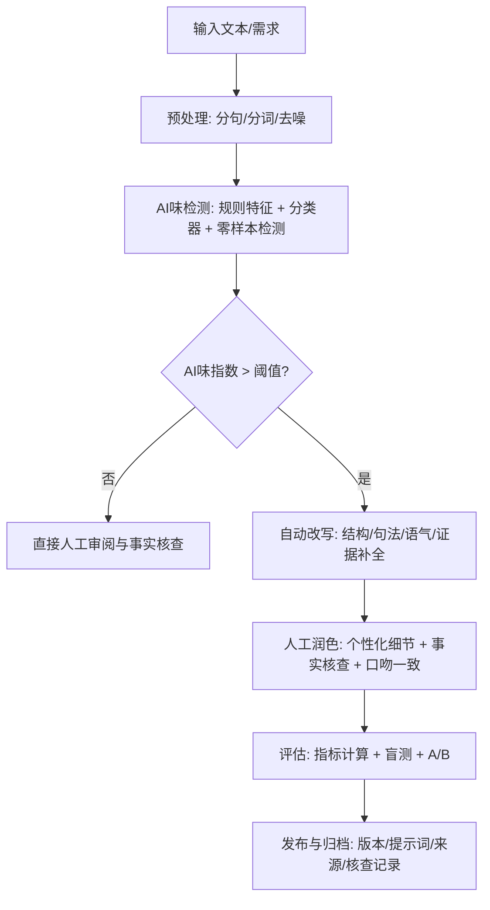

# 去除 AI 味与 AI 话术的深度调研报告

## 执行摘要

本报告将“AI味”与“AI话术”转化为可操作、可量化的检测与改写体系：从**模板化话术密度、语言平滑度（低爆发性）、重复与同义回环、抽象泛化倾向、事实可核查性不足**等维度建立指标，并提出可计算的**AI味指数（0–100）**，用于流程化治理而非“判卷式定性”。研究优先梳理中文政策与标准（含生成式AI、深度合成、内容标识相关规制），结合主流学术检测范式（GLTR、DetectGPT/Fast-DetectGPT、Binoculars、风格对比学习等），指出：**单一检测器不可靠且存在偏差风险**，应采用“多域数据 + 多方法集成 + 可解释性 + 人工盲测”的混合方案。报告给出可复现的端到端流程（输入→检测→自动改写→人工润色→评估与盲测），列出常见AI话术库与替换策略、去AI化方法与工具对比，并提供覆盖新闻/营销/学术的5组中文示例与量化评分、可视化图表，以及分阶段实施路线图与数据资源清单。citeturn14search29turn17search0turn14search1turn19search0turn15view0

## 研究目标与问题定义

**研究目标**：在不限定行业与预算的条件下，构建一个可落地的“去AI化”体系，解决三类常见痛点：  
其一，文本被读者感知“像AI写的”（读感层面）。其二，被内容审核/学术系统/编辑团队认为“AI痕迹明显”（风控层面）。其三，文本缺乏事实支撑与个性细节，导致可信度与转化效果下降（业务层面）。citeturn16view1turn19search0turn14search29

**操作性定义**（建议作为组织内部共识模板）：  
- **AI话术**：指在大模型生成文本中高频出现、可被规则或统计稳定捕捉的“表达模版”，例如：过度结构化的铺陈（“首先/其次/最后”）、过度中性礼貌、泛化空话（“具有重要意义”“有望推动”）、风险规避式模糊（“可能”“在一定程度上”）、“总结式收口”泛滥（“总而言之/综上所述”）等。这类话术通常具有可复用的短语级特征，适合**短语库 + 句法模板 + n-gram统计**检测。citeturn14search1turn14search29  
- **AI味**：指人类读者对文本“像机器写的”的综合感知结果，通常由多层因素叠加：  
  1) **概率与采样痕迹**：词选择过于“高概率”、熵较低、分布更集中（常用于GLTR类可视化与统计检测）。citeturn14search1turn14search11  
  2) **风格与节奏过度平滑**：句长、句式、语气波动小（“低爆发性/低burstiness”），段落结构均匀。citeturn14search0turn14search4turn19search0  
  3) **语义泛化与证据缺失**：观点正确但空泛、缺乏可核查细节（时间、地点、数据、来源、引用）。citeturn16view1turn5search4  
  4) **事实性错误与幻觉风险**：生成内容可能“貌似合理但不真实”。（尤其在新闻、科普、学术摘要等高事实密度文体中影响放大。）citeturn5search4turn5search1  
  5) **跨模型/跨域可迁移特征**：不同模型可能共享相近训练语料与写作倾向，“风格差异”反而成为更稳的判别方向。citeturn7search1turn14search29  

**识别维度与可量化指标**（示例指标库，可作为MVP版本）  
下表从“可计算性”角度组织，便于直接落地成脚本/服务（指标可按域加权）：

| 维度 | 典型“AI味”表现 | 可量化指标（示例） | 计算要点 |
|---|---|---|---|
| 词汇与短语 | “总之/此外/值得注意”高频；抽象名词堆叠 | 模板短语密度；抽象名词密度；功能词分布偏差 | 短语词典 + 正则；对照人类语料基线做z-score |
| 句法与节奏 | 句式均匀、句长波动小 | 句长均值/方差；burstiness（句长变异系数等） | 分句后统计；不同文体需分开基准 |
| 重复模式 | 同义回环、句式复用 | n-gram重复率；trigram重复度；段落开头“模板化”占比 | 统计唯一n-gram比例；检测段首结构 |
| 概率痕迹 | 用词“过于高概率”、熵低 | 平均对数似然/困惑度；token-rank分布（GLTR） | 需语言模型打分；或用GLTR/类似实现 |
| 语义与话语结构 | 逻辑跳跃、论证薄、缺证据 | 论据/引用密度；可核查断言密度（数字/时间/来源） | 抽取数字/日期/来源短语；可人工复核 |
| 事实性 | 细节不实/张冠李戴 | 事实核查通过率；不一致率（如QAGS/SummaC思路） | 将断言拆分为claim→检索/对照→判定 citeturn5search2turn5search11 |

### AI味指数的构成与公式建议

为避免“单一检测器=真相”的误用，建议把AI味指数定位为**过程质量指标**（用于改写前后对比、团队一致性与A/B评估），并采用“可解释的分项得分 + 可校准权重”的结构。citeturn19search30turn19search0turn14search29

**建议的AI味指数（AITI, 0–100）**：

记各分项子分数均归一化到 \([0,1]\)（以**同域人类语料**为基线做z-score或min-max），定义：  
- \(s_{\text{det}}\)：集成检测分数（监督分类器 + 零样本检测 + 统计检测的加权平均）citeturn17search0turn7search2turn14search1  
- \(s_{\text{smooth}}\)：语言平滑度（burstiness 的反向指标）citeturn14search0turn14search4  
- \(s_{\text{tmpl}}\)：模板短语/结构密度（“首先/其次/综上”等）  
- \(s_{\text{rep}}\)：重复度（n-gram重复、段首重复、同义回环）  
- \(s_{\text{gen}}\)：泛化/抽象化倾向（抽象名词密度、可核查细节密度的反向）  
- \(s_{\text{fact}}\)：事实风险（= 1 - 事实核查通过率；没有核查时用“可核查断言缺失”作代理）citeturn5search4turn5search1  

则：
\[
\text{AITI}=100\cdot \sigma\left(\beta_0+w_d s_{\text{det}}+w_s s_{\text{smooth}}+w_t s_{\text{tmpl}}+w_r s_{\text{rep}}+w_g s_{\text{gen}}+w_f s_{\text{fact}}\right)
\]
其中 \(\sigma\) 为sigmoid，用于把线性组合压到0–100；权重 \(w\) 的初始值可按“读感贡献”设置，再用人工标注回归校准（见后文数据与标注）。citeturn8search0turn18search2  

**落地建议**：  
- **MVP（两周内）**：先不用 \(s_{\text{det}}\) 的复杂集成，仅用可解释的规则/统计分项（tmpl/rep/smooth/gen）形成“结构性AI味指数”，用于改写优化闭环。  
- **进阶（1–3个月）**：引入监督分类器（中文RoBERTa/DeBERTa等）与零样本检测（DetectGPT/Binoculars类），再用SHAP/特征重要性解释权重与误判来源。citeturn17search0turn7search2turn18search2turn8search0  

## 文献与资源优先级

### 优先级原则

- **最高优先**：中文官方法规/标准/指南（决定“什么必须做、什么不能做”）；其次为顶会/期刊原始论文与公开数据集（决定“方法上限与边界”）。citeturn15view0turn16view1turn16view0  
- **中优先**：权威机构与主流工具的官方文档（决定“可用能力与工程形态”）。citeturn19search7turn10search1turn10search0  
- **低优先**：二手解读、媒体报道、营销文章（用于补充上下文，不作为关键结论依据）。citeturn19search2  

### 关键参考清单（按优先级排序）

| 优先级 | 类型 | 标题 | 作者/机构（首要） | 年份 | 链接 |
|---|---|---|---|---:|---|
| 高 | 法规 | 《人工智能生成合成内容标识办法》 | 中国网信部门等 | 2025 | citeturn15view0 |
| 高 | 法规 | 《生成式人工智能服务管理暂行办法》 | 中国网信部门等 | 2023 | citeturn16view1 |
| 高 | 法规 | 《互联网信息服务深度合成管理规定》 | 中国网信部门等 | 2022 | citeturn16view0 |
| 高 | 法规 | 《互联网信息服务算法推荐管理规定》 | 中国网信部门等 | 2022 | citeturn4search0 |
| 高 | 标准/指南 | TC260-003《生成式人工智能服务安全基本要求》 | 全国网安标委（SAC/TC260） | 2024 | citeturn13view0 |
| 高 | 论文 | GLTR: Statistical Detection and Visualization of Generated Text | entity["people","Sebastian Gehrmann","nlp researcher"] 等 | 2019 | citeturn14search1 |
| 高 | 论文 | DetectGPT: Zero-Shot Machine-Generated Text Detection… | entity["people","Eric Mitchell","cs researcher"] 等 | 2023 | citeturn17search0 |
| 高 | 论文 | Fast-DetectGPT: Efficient Zero-Shot Detection… | entity["people","Guangsheng Bao","nlp researcher"] 等 | 2023/2024 | citeturn17search1turn17search13 |
| 高 | 论文 | Spotting LLMs With Binoculars: Zero-Shot Detection… | entity["people","Abhimanyu Hans","ml researcher"] 等 | 2024 | citeturn7search2 |
| 高 | 数据集/论文 | HC3: Human ChatGPT Comparison Corpus… | entity["people","Biyang Guo","nlp researcher"] 等 | 2023 | citeturn7search0 |
| 高 | 论文 | GPT detectors are biased against non-native English writers | entity["people","Weixin Liang","stanford researcher"] 等 | 2023 | citeturn19search0turn19search4 |
| 中 | 论文 | DeTeCtive: Detecting AI-generated Text via Multi-Level Contrastive Learning | entity["people","Xun Guo","ml researcher"] 等 | 2024 | citeturn7search1turn7search5 |
| 中 | 论文/数据集 | LGT-AA 94k（10模型×7领域的中英文归因数据集） | entity["organization","Beijing University of Posts and Telecommunications","beijing, china"] 等 | 2025 | citeturn2search6 |
| 中 | 综述 | A Survey on LLM-Generated Text Detection | entity["people","Jing Wu","nlp researcher"] 等 | 2025 | citeturn14search29 |
| 中 | 水印 | A Watermark for Large Language Models | entity["people","John Kirchenbauer","ml researcher"] 等 | 2023 | citeturn17search2turn17search6 |
| 中 | 水印 | SynthID-Text（Scalable watermarking…） | entity["people","Sumanth Dathathri","research scientist"] 等 | 2024 | citeturn17search3 |
| 中 | 工具文档 | Turnitin：AI Writing Report 低分段 *% 策略 | entity["company","Turnitin","plagiarism detection company"] | 2026 | citeturn19search7turn19search11 |
| 中 | 工具文档 | OpenAI：AI Classifier 下线（低准确率） | entity["company","OpenAI","ai research company"] | 2023 | citeturn19search30 |
| 中 | 工具文档 | Notion AI for Docs（摘要/改写/语气调整） | entity["company","Notion","productivity software company"] | 2025–2026 | citeturn10search1turn10search23 |
| 中 | 工具文档 | Grammarly：tone rewrite/paragraph rewrites | entity["company","Grammarly","writing assistant company"] | 2022–2026 | citeturn10search4turn10search10 |
| 中 | 中文NLP工具 | HanLP（中文分词/句法等） | entity["organization","HanLP GitHub","nlp project repo"] | 持续更新 | citeturn6search0 |
| 中 | 中文NLP工具 | LTP（中文依存句法/语义等） | entity["organization","HIT-SCIR","nlp research lab"] | 持续更新 | citeturn6search1turn6search5 |
| 中 | 中文写作工具 | WPS AI（写作/改写/长文处理） | entity["company","Kingsoft Office","office software company"] | 2023–2025 | citeturn6search7turn6search3 |
| 中 | 中文写作工具 | 秘塔写作猫（改写/校对/续写） | entity["company","秘塔科技","shanghai, china"] | 2023–2025 | citeturn6search10turn6search18 |

## 方法论与数据集构建

### 自动检测方法全景

**统计/特征工程路线**（可解释、成本低，适合MVP）：  
- **模板与话术特征**：短语密度、段首模板、连接词/总结句比例。  
- **重复与“高概率用词”代理特征**：n-gram重复率、词汇丰富度、罕见词比例；GLTR进一步以“token rank/熵/概率桶”可视化，帮助人类发现生成痕迹。citeturn14search1turn14search11  
- **节奏特征**：burstiness（句长方差/变异系数）、标点分布、长短句交替度；许多检测器/行业工具会把困惑度与burstiness作为信号（但需警惕被偏差放大）。citeturn14search0turn14search4turn19search0  

**监督分类路线（ML/DL）**（精度上限高，但更依赖数据、易域漂移）：  
- 文本编码器（中文RoBERTa/DeBERTa/ERNIE类）+ 二分类/多分类（人类/模型A/模型B…）。HC3等语料显示：同域训练的分类器能较好区分，但跨域、跨模型会显著退化。citeturn7search0turn14search29  
- 建议把任务从“人类 vs AI”升级为“**写作风格表征学习**”，如对比学习/多任务学习（DeTeCtive强调区分“作者风格”比二分类更关键）。citeturn7search1turn7search5  

**零样本/近零样本路线**（不依赖标注，但对模型可得性敏感）：  
- **DetectGPT/Fast-DetectGPT**：基于对数概率曲率（及其条件曲率变种）进行检测，不训练额外分类器。citeturn17search0turn17search1  
- **Binoculars**：用一对相关语言模型对同一文本打分并对比，达到零样本检测效果。citeturn7search2  

**重要边界**：检测器并不等于“真伪判定”。权威证据表明：检测器可能对不同人群/写作习惯存在偏差（例如对非母语英语写作者误判更高），且简单改写/提示词策略可能显著影响检测结果。citeturn19search0turn19search20turn19search5  

### 可解释性方法

- **SHAP**将特征贡献解释为可加性“Shapley值”，适合把“为什么像AI”拆解为可沟通的因素（例如：模板短语导致 +0.18，句长过于平滑导致 +0.12）。citeturn8search0turn18search2  
- 线性模型（如逻辑回归）可用系数做粗粒度特征重要性，适合MVP快速反馈。citeturn18search1  

### 人工评估与盲测设计

建议把人工评估拆成两层：  
- **读感层**（主观但关键）：AI味感知、自然度、是否“像某个具体作者/团队的口吻”。  
- **质量层**（更客观）：可读性、信息密度、证据充分度、事实核查通过率。citeturn14search29turn5search4  

**评分量表（推荐 1–5 分Likert）**：  
- AI味：1=完全不像AI，5=非常像AI  
- 自然度：1=生硬，5=自然  
- 可读性：1=难读，5=顺滑  
- 证据充分度：1=几乎无依据，5=引用/数据/来源清晰  
- 事实准确：1=多处错误，5=高一致/可核查  

**盲测要点**：  
- 文本顺序随机化；评审者不知道版本（AI原文/自动改写/人工润色）。  
- 同一评审者对同主题文本最多看一个版本，避免记忆效应（between-subject更稳）。  
- 统计检验：Likert可用Mann–Whitney U / Kruskal–Wallis；连续指标可用t检验/ANOVA；同时报告效应量（Cohen’s d 或 Cliff’s delta）。  

### 数据集需求与构建方法

**总体原则**：多域（新闻/营销/学术）+ 多模型 + 多生成参数 + 多提示策略，避免“只学会识别某一类AI风格”。citeturn7search0turn2search6turn14search29  

**人类文本来源**（建议优先“可公开复用/版权清晰”的语料）：  
- 新闻：权威媒体公开稿源、机构公告与政策原文（可作为事实对照）。citeturn15view0turn16view1  
- 营销：品牌官网、产品说明、客服FAQ、真实落地页；需注意版权授权。  
- 学术：公开论文摘要/引言、开源文档、技术博客（确保许可）。  

**AI文本生成策略**：  
- 至少覆盖：主流商用模型 + 主流开源模型（≥3家/≥5个模型版本），并对每个模型采样不同温度/Top-p/长度约束。  
- 提示词分层：  
  1) “常规写作提示”→更像普遍AI输出  
  2) “强风格提示（带人设/记忆/口吻）”→更接近真实使用场景  
  3) “改写提示（paraphrase/润色）”→模拟二次加工，检验检测鲁棒性citeturn19search5turn19search0  

**标注策略**（推荐多标签，而非仅二分类）：  
- 生成来源：human / model_family / model_id（可选）  
- 文体：news / marketing / academic  
- AI话术标签（多选）：模板化、泛化、过度礼貌、模糊化、重复、证据缺失、逻辑跳跃、疑似幻觉等  
- 质量标签：事实核查通过率、可核查断言数、引用/来源清晰度  

**样本量建议**：  
- MVP（2–4周）：每域 2,000–5,000 条（human:ai≈1:1），总量 6,000–15,000。  
- 可用模型（1–3月）：每域 20,000+，并保证“跨模型/跨参数”的覆盖。HC3与LGT-AA这类公开资源显示：**万级到十万级**更利于跨域泛化评估与归因。citeturn7search0turn2search6  

## 常见 AI 话术库与替换策略

下表给出高频类别与“中英对照”示例（示例为研究用抽象模板，可直接转为规则库/负面提示词）：

| 类别 | 语言特征 | 中文示例 | 英文示例 | 可替换策略 |
|---|---|---|---|---|
| 过度通用化 | 大而全、缺少限定条件与数据 | “这一举措具有重要意义，将带来深远影响。” | “This is very important and will have a profound impact.” | 增加边界与量化：影响谁、在什么时间窗、用什么指标衡量 |
| 过度中性/礼貌 | 语气过稳、缺少立场或取舍 | “建议综合考虑多方面因素，谨慎决策。” | “It’s recommended to consider various factors carefully.” | 明确决策标准：给可执行的3条判断阈值/优先级 |
| 结构化模板堆叠 | “首先/其次/最后”“总之”机械收口 | “首先…其次…最后…综上所述…” | “First… Second… Finally… In summary…” | 用“问题—证据—结论”替代“顺序罗列”；减少总结句密度 |
| 事实模糊化 | “可能/通常/一定程度”过多 | “可能在一定程度上提升效率。” | “It may improve efficiency to some extent.” | 用可核查断言替代：提升多少、基于何数据/案例；不确定则写“未知/待验证”并列验证方法 |
| 论证空心化 | 观点正确但无证据 | “行业将迎来新的机遇与挑战。” | “The industry will face new opportunities and challenges.” | 补充一条具体案例、一条数据或一条可追溯来源 |
| 同义回环/重复句式 | “换壳重复”、词汇熵低 | “提升效率…提高效率…优化效率…” | “Improve efficiency… enhance efficiency…” | 合并与删减；用一处更精准表述替代三次表达 |
| 逻辑跳跃 | 连接词堆砌但因果不成立 | “因此…同时…从而…” | “Therefore… meanwhile… thus…” | 强制写出因果链：前提→机制→结果；缺前提就删结论 |
| “安全型”免责声明泛滥 | 以风险规避代替内容 | “仅供参考…请自行判断…” | “For reference only…” | 把免责声明移到末尾一行；正文用证据与边界说话 |

## 去AI化技术与工具对比

去AI化的核心不是“改得更像人”，而是把文本从“**平均化的机器叙述**”推进到“**有证据、有取舍、有作者特征**”的成品。考虑到检测器并不可靠且可能存在偏差，建议把“去AI化”定义为**提升文本质量与作者一致性**，而不是“对抗检测”。citeturn19search0turn19search30turn19search7  

### 方法对比表（含开源/商用落地示例）

| 方法 | 原理 | 优点 | 缺点 | 适用场景 | 实现难度 | 示例（开源/商用） |
|---|---|---|---|---|---|---|
| 规则化去模板 | 删除/替换高频AI话术与段落模板 | 成本低、可控、可解释 | 易“过拟合规则”；可能损害文风 | 新闻快稿、批量内容质检 | 低 | 组织内“话术lint”自建 |
| 句法重构 | 合并/拆分句子，增加长短句起伏 | 明显改善读感（burstiness） | 可能引入歧义 | 新闻/营销通用 | 中 | 结合中文句法工具（HanLP/LTP）citeturn6search0turn6search1 |
| 风格迁移/品牌口吻 | 用风格分类器或提示词约束语气、术语与禁用词 | 最贴近“像你/像品牌” | 数据与评审成本高 | 营销、品牌、公关 | 中–高 | entity["company","Writer","writer.com ai company"] 风格指南能力citeturn10search3turn10search29 |
| 自动改写（LLM） | 用模型二次生成：改结构、换表达、补细节 | 效率高、可做多版本 | 容易继续“AI味”；可能改错事实 | 初稿加速、批量润色 | 中 | Notion AI 改写/语气调整citeturn10search1 |
| 同义替换/释义生成 | 词级/短语级替换 | 快速降低重复 | 可能语义漂移、变“假人话” | 轻量改写 | 中 | entity["company","QuillBot","paraphrasing tool company"] Paraphraser/Humanizerciteturn9search3turn9search28 |
| 个性化细节注入 | 引入时间点、场景、动作、对比、反例 | 去AI味最有效之一 | 需要真实素材支撑 | 观点文、营销、报告 | 中 | 组织内“素材卡片库” |
| 事实核查与证据化 | claim抽取→检索/对照→标注来源 | 显著提升可信度 | 成本高；需要知识库 | 新闻、学术、合规内容 | 高 | 结合政策原文/权威资料citeturn15view0turn16view1 |
| 水印/溯源（配套） | 在生成端嵌入可检测信号 | 有助透明与合规 | 鲁棒性与生态兼容仍在演进 | 平台级治理 | 高 | 研究水印与SynthID-Textciteturn17search2turn17search3turn17search19 |
| “对抗检测式人类化” | 以绕过检测为目标的改写 | 可能降低被检出 | 高伦理/合规风险；助长欺骗 | 不建议用于对外/教育场景 | 中 | 检测规避研究显示其风险citeturn19search5turn19search0 |

## 可复现流程与评价体系

### 端到端流程（推荐作为团队SOP）

### 量化指标与计算方法

为保证“可复现”，建议每次改写迭代都输出同一组指标（并记录版本号与提示词）。核心指标建议如下：

**可区分性（AI-distinctiveness）**  
- 定义：文本被判为机器生成的概率或可分性分数。  
- 计算：集成多个检测器输出（监督分类器概率、DetectGPT/Fast-DetectGPT分数、GLTR统计特征或Binoculars分数）。citeturn17search0turn17search1turn7search2turn14search1  
- 注意：检测器可能存在偏差与误报，不能用于“单点定罪”。用作趋势指标更合适。citeturn19search0turn19search30turn19search7  

**自然度（Naturalness）**  
- 定义：读者对“像人写的、顺口”的主观评分。  
- 计算：盲测Likert均值；可辅以节奏特征（burstiness）做解释。citeturn14search0turn19search0  

**可读性（Readability）**  
- 定义：单位时间内理解成本。  
- 计算：句长均值/方差、标点密度、段落长度分布；中文可参考CRIE等可读性研究框架与指标体系。citeturn2search3  

**原创度/原创感（Originality）**  
- 定义：文本在表达与结构上的“非模板化”程度。  
- 计算：n-gram重复率反向指标、与模板句库的相似度、与组织历史内容的相似度（MinHash/SimHash/向量相似度）。  

**事实准确率（Fact accuracy）**  
- 定义：可核查断言中，被证据支持的比例。  
- 计算：  
  1) claim抽取（含数字、日期、实体、因果断言）  
  2) 对照证据（政策原文、权威资料、内部数据）  
  3) 通过率 = verified_claims / total_claims  
- 可借鉴事实一致性评估思路，如QAGS/SummaC等在摘要任务中的“对照一致性”框架（迁移到文章核查）。citeturn5search2turn5search11turn5search4  

### A/B测试与盲测细节建议

- **A/B对象**：AI原文 vs 自动改写 vs 人工润色（三组）。  
- **样本量建议**：每个文体至少 50–100 篇短文（或 200–300 段落级样本）；评审者≥20（越多越稳），每个样本≥3人评分。  
- **统计检验**：  
  - Likert：Kruskal–Wallis + 事后检验；  
  - 连续指标：ANOVA 或 Welch t-test；  
  - 同时报告效应量与置信区间。  

### 示例与对比（新闻×2、营销×2、学术×1）

说明：以下文本用于展示“AI原文→自动改写→人工润色”的改写方向与指标计算方式；其中新闻示例的事实点来自官方与工具文档，可核查。citeturn15view0turn19search7turn10search1turn17search0  

**新闻示例A：内容标识办法**

> **AI原文**：近日，相关部门发布了《人工智能生成合成内容标识办法》，对人工智能生成合成内容的标识提出了明确要求。该办法旨在促进人工智能健康发展，规范标识管理，保护公众合法权益。总体来看，新规强调了显式标识与隐式标识的重要性，并要求平台在内容传播过程中加强提示。未来，随着规则落地，行业有望形成更加透明、可信的内容生态。  

> **自动改写**：国家网信部门等单位印发《人工智能生成合成内容标识办法》，将“显式标识+隐式标识”作为基本框架：用户能直接看到的提示（如文字或图形），以及写入文件元数据、便于机器识别的标记。对内容平台而言，新规的核心不是“多贴一个标签”，而是把生成内容的来源与流转链条做成可追溯的最小闭环——从生成端到传播端，均需要具备可核验的标识与配套能力。  

> **人工润色**：国家网信部门等发布《人工智能生成合成内容标识办法》，明确“显式标识”和“隐式标识”两类要求：对特定生成合成服务，应在文本、音频、图片、视频或虚拟场景中以文字、图形、语音等方式作出显著提示；同时，服务提供者需在文件元数据中写入生成属性、服务提供者标识、内容编号等制作要素信息，并鼓励采用数字水印等隐式标识。该办法自2025年9月1日起施行，并提出传播平台在核验或检测到生成痕迹后，应在发布内容周边作出相应提示。citeturn15view0  

**新闻示例B：Turnitin 低分段 *% 策略**

> **AI原文**：随着AI写作工具的普及，学术诚信问题受到广泛关注。Turnitin等平台提供了AI写作检测功能，用于帮助教师识别可能的AI生成内容。一般来说，系统会给出一定的检测比例，并提示用户关注相关内容。需要注意的是，AI检测可能存在误判，因此应综合多种证据进行判断。总之，合理使用工具并保持透明沟通，是解决争议的关键。  

> **自动改写**：Turnitin 的官方说明强调：AI检测模型可能出现误报，因此报告呈现方式会对低置信区间做“降噪处理”。当检测比例落在较低区间时，系统会以更保守的方式显示结果，以减少把人类写作误判为AI写作的风险。这意味着“检测分数”更像线索而非结论：更可靠的做法是补齐证据链——写作过程、草稿版本、参考资料与口头答辩等。  

> **人工润色**：Turnitin 帮助文档提示：AI检测存在误报可能，因此当检测分数处于1%—19%区间时，报告会以“*%”提示且不展示具体百分比或高亮片段；达到20%及以上阈值时才呈现具体比例与标注信息。该设计被解释为“降低低分段误读与误报影响的保守呈现策略”，结果应作为进一步核查信号而非最终裁决。citeturn19search7turn19search11  

**营销示例A：WPS AI 写作**

> **AI原文**：WPS AI是一款强大的智能写作工具，能够帮助用户快速生成高质量的文档内容。它支持多种场景，包括写报告、写方案、写邮件等。通过智能大纲、内容生成和表达优化，WPS AI可以显著提升效率，节省时间。无论你是学生还是职场人士，都可以使用WPS AI轻松完成写作任务。  

> **自动改写**：在WPS里写文档，最耗时的往往不是打字，而是从“空白页”走到“可交付初稿”。WPS AI把这段路程缩短了：你给主题和要点，它先生成结构，再在指定段落做扩写、润色或改写。更像一个“随叫随到的编辑助理”，而不是一键替你写完——你仍然保留对内容取舍、措辞风格与格式排版的控制权。  

> **人工润色**：把“起草—整理—优化”放在同一个编辑界面里：一键唤起AI，先生成大纲或段落，再对选中内容做续写、改写和表达优化。它给的是“可编辑的骨架”。你负责加事实、加数据、加语气。这样更快，也更像你的写法。citeturn6search7turn6search3  

**营销示例B：Notion AI 文档协作**

> **AI原文**：Notion AI可以帮助用户更高效地写作和整理文档。它能够生成摘要、提取要点、翻译文本，并根据需要改写内容以调整语气和风格。使用Notion AI，你可以节省大量时间，让团队协作更加顺畅。现在就试试Notion AI，提升你的工作效率吧！  

> **自动改写**：Notion AI适合“把已有材料变得更好用”：在页面里选中一段笔记，你可以让它生成摘要、整理行动项，或者把同一段话改得更正式/更口语。它的价值不是替代写作，而是减少“整理成本”——把零散的会议记录、项目想法，快速变成能协作、能追踪、能复用的文档。  

> **人工润色**：Notion AI的常见用法是“就地加工”：在同一页里高亮文本后选择Ask AI（或用/AI），即可生成摘要、提取关键点与行动项、做中英文互译，或把段落改写成不同语气。它利用页面上下文辅助生成，因此更适合在团队知识库里做二次编辑与结构化整理，而不是脱离素材凭空起草。citeturn10search1turn10search23  

**学术示例：DetectGPT 思路**

> **AI原文**：随着大语言模型的快速发展，机器生成文本检测变得越来越重要。DetectGPT是一种零样本检测方法，它不需要训练额外的分类器，也不需要标注数据集。该方法通过分析文本在语言模型概率空间中的特性来判断文本是否由模型生成。实验表明，DetectGPT在多个任务上取得了较好的效果，为生成文本检测提供了新的方向。  

> **自动改写**：DetectGPT走的是“模型自证”路线：利用语言模型的概率几何特性，对原文做扰动，再对比两者的概率曲率来判断来源。它不靠额外标注，也不需要单独训练判别器。代价是推断时要能计算（或近似）目标模型的概率，而在重度改写、跨域文本时，表现容易受影响。  

> **人工润色**：DetectGPT提出一种零样本思路：在给定语言模型下，模型采样文本往往落在对数概率函数的“负曲率区域”。方法通过对文本做随机扰动，并比较原文与扰动文本的概率曲率来判别是否为模型生成。论文强调它不依赖额外标注数据或训练单独分类器，但也指出检测性能会受到文本改写、领域迁移以及生成策略差异等因素影响，因此更适合作为组合检测链路中的一环，而不是单点“判卷器”。citeturn17search0turn17search12  

### 示例评分表与可视化

下表对上述示例给出一组“可复现的指标计算”结果（其中AI味指数/自然度/可读性/原创感为示例性计算；事实准确率为人工核查评分，用于展示评审闭环的形态）。

| group                          | domain   | 版本     |   AI味指数↓ |   自然度↑ |   可读性↑ |   原创感↑ |   事实准确率↑ |
|:------------------------------|:---------|:---------|------------:|----------:|----------:|----------:|--------------:|
| 学术示例：DetectGPT 思路       | 学术     | AI原文   |        40.2 |      59.8 |     100.0 |      82.1 |            90 |
| 学术示例：DetectGPT 思路       | 学术     | 人工润色 |        24.9 |      75.1 |      98.2 |      88.0 |           100 |
| 学术示例：DetectGPT 思路       | 学术     | 自动改写 |        28.9 |      71.1 |      77.4 |      87.0 |            95 |
| 新闻示例A：标识办法发布        | 新闻     | AI原文   |        49.7 |      50.3 |     100.0 |      85.7 |            80 |
| 新闻示例A：标识办法发布        | 新闻     | 人工润色 |        21.3 |      78.7 |      63.4 |      95.0 |           100 |
| 新闻示例A：标识办法发布        | 新闻     | 自动改写 |        26.2 |      73.8 |      47.1 |      84.0 |            90 |
| 新闻示例B：Turnitin 低分段处理 | 新闻     | AI原文   |        63.4 |      36.6 |     100.0 |      85.7 |            85 |
| 新闻示例B：Turnitin 低分段处理 | 新闻     | 人工润色 |        27.6 |      72.4 |      97.9 |      94.6 |           100 |
| 新闻示例B：Turnitin 低分段处理 | 新闻     | 自动改写 |        32.1 |      67.9 |      74.4 |      86.6 |            90 |
| 营销示例A：WPS AI 写作         | 营销     | AI原文   |        33.0 |      67.0 |     100.0 |      84.0 |            90 |
| 营销示例A：WPS AI 写作         | 营销     | 人工润色 |        16.8 |      83.2 |     100.0 |      92.7 |            95 |
| 营销示例A：WPS AI 写作         | 营销     | 自动改写 |        24.8 |      75.2 |      74.0 |      87.6 |            90 |
| 营销示例B：Notion AI 文档协作  | 营销     | AI原文   |        43.6 |      56.4 |     100.0 |      79.0 |            95 |
| 营销示例B：Notion AI 文档协作  | 营销     | 人工润色 |        18.3 |      81.7 |      89.5 |      90.7 |            95 |
| 营销示例B：Notion AI 文档协作  | 营销     | 自动改写 |        20.9 |      79.1 |      88.3 |      86.5 |            95 |

下图给出AI味指数分项“示例权重”（用于展示可解释结构；真实项目应由标注数据校准权重）：

下图展示示例文本在三种版本下的AI味指数分布（可用于汇报改写策略是否整体降低AI味）：

## 风险伦理合规与路线图

### 风险与伦理

**误导性与署名风险**：去AI化若被用于掩盖机器代写事实，可能构成对受众的误导；在教育、新闻、合规报告等场景尤其敏感。多项研究指出检测器可能被简单改写影响，因此“以绕过检测为目标”的做法会把组织带入对抗螺旋并放大信任风险。citeturn19search5turn19search0turn14search29  

**误报与公平性风险**：检测器可能对不同人群/语言能力存在系统性偏差（非母语写作者被误判更高），不宜作为单一处置依据。citeturn19search0turn19search20  

**版权与数据合规风险**：中文监管框架强调训练数据合法来源、知识产权与个人信息保护义务，以及提升生成内容准确性与可靠性等要求；同时对虚假信息、虚假新闻传播有明确禁止性条款。citeturn16view1turn16view0  

**内容标识与反篡改要求**：最新《标识办法》对显式/隐式标识、传播平台核验与提示、以及禁止恶意删除/篡改/伪造标识作出明确要求；这意味着组织在对外内容治理上更需要“可追溯与透明”的合规路径，而不是“只改文风”。citeturn15view0  

**国际监管趋势（概览）**：欧盟层面在生成内容透明度、深度伪造标识与责任方面持续强化（建议在跨境业务场景同步评估披露与标识义务）。citeturn3search10turn3search11  

### 实施建议与时间表

**短期（两到四周）：工具/流程快速落地**  
- 建立“AI话术黑名单/替换库”与文体化写作规范：新闻（事实/来源优先）、营销（品牌口吻/场景细节优先）、学术（定义/方法/限制优先）。  
- 上线最小可用检测：模板短语密度、重复度、句长波动、可核查断言密度 → 输出AI味指数与改写建议清单。  
- 人工流程固化：每篇内容必须补齐“证据与边界”（至少：来源/时间/数据/不确定性说明）。citeturn16view1turn5search4  

**中期（一个到三个月）：模型/数据建设**  
- 构建多域对照数据集（human/多模型AI/二次改写AI），并做细粒度话术标注。citeturn7search0turn2search6  
- 训练“域内分类器 + 风格表征模型”，用SHAP解释误判与“AI味主因”。citeturn18search2turn8search0turn7search1  
- 建立事实核查流水线：claim抽取→检索/对照→证据挂载→通过率统计。citeturn5search2turn5search11  

**长期（四到十二个月）：组织策略与合规体系**  
- 把“内容溯源/标识/留痕”纳入内容系统：对外发布前自动检测标识与来源；对内保留版本与核查记录，满足审计与争议处理。citeturn15view0turn13view0  
- 建立“允许AI辅助的边界”：明确哪些环节可用AI（起草/改写/结构化），哪些必须人工（事实核查、观点责任、署名确认）。  
- 关注水印与溯源新进展，但以“透明披露+证据化写作”作为主路径（因为水印鲁棒性仍是挑战）。citeturn17search2turn17search3turn17search19  

### 需要进一步采集的数据与资源清单（含优先级与样本量）

| 优先级 | 数据/资源 | 用途 | 建议规模 |
|---|---|---|---|
| 高 | 三域人类高质量语料（新闻/营销/学术），含版权/许可记录 | 建立人类基线、训练/评估 | 每域≥2万段落（或≥5千篇短文） |
| 高 | 多模型AI生成语料（含不同参数与提示策略） | 训练可泛化检测器、覆盖真实使用 | 每域≥2万段落；模型≥5；温度/Top-p分层 |
| 高 | AI话术标签体系与标注指南（片段级） | 把“AI味”拆成可改的原因 | 每域≥5千段落做细粒度标注 |
| 高 | 事实核查证据库（政策原文、权威数据、内部指标） | 计算事实准确率、降低幻觉风险 | 按业务持续增量 |
| 中 | 团队/品牌写作样本库（含优秀稿与禁用写法） | 风格迁移、口吻一致性 | 500–2,000篇代表作 |
| 中 | 检测器集成与评估基准（监督+零样本+统计） | 抗域漂移、减少误判 | 每次模型更新跑全套基准 |
| 中 | 盲测评审池（编辑/业务/外部读者） | 自然度与AI味的稳定测量 | ≥20评审者，按季度复测 |
| 低 | 水印/溯源能力评估（如SynthID相关生态） | 平台级溯源能力规划 | 视业务合规需求推进 citeturn17search3 |

（完）